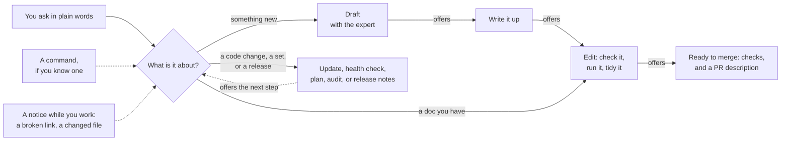

# Docs Assist

A Claude Code plugin for turning what you know into documentation.
You bring the knowledge, expertise, and steps.
The plugin handles structure, standards, and drafting.

**Who it's for:** engineers, support leads, PMs, and repo owners who have something to document and don't want to become documentation experts to do it.

## Why use it

Most documentation gaps aren't a writing problem.
They're a knowledge-extraction problem: the person who knows the answer doesn't have time to structure it, and the person with time doesn't have the knowledge.

Docs Assist closes that gap by acting as the documentation expert in the session, in three steps:

1. **Draft**: it asks the questions a technical writer would ask, steers you toward what a good doc needs, and checks what you say against the code rather than taking it on faith.
1. **Write**: it writes the draft up in your project's conventions, and a separate reviewer questions anything it added until it holds up.
1. **Edit**: it checks every claim against the code and runs every step, then edits the wording, so you answer a few questions instead of reviewing formatting.

Each step offers the next, and they can be split across people: an expert drafts, and a teammate writes it up and edits it.

It also helps once a document exists, not just while it's being written:

- Checks a docs set's health and tells you the one thing worth fixing first.
- Audits a finished document by reconstructing what it claims and ruling on each claim against the code.
- Edits any doc the same way: every claim checked, every step run, then the wording.
- Verifies a procedure by actually running its steps in an isolated workspace.
- Updates the docs affected by a code change, for your review.
- Turns a release's commits and pull requests into release notes, asking you for the why.
- Keeps notes the way a writer does beside an expert (questions and their answers, decisions, what ran) and offers to turn them into your pull request description, doc by doc if you want.

It delivers documentation and leaves nothing else behind: its notes and drafts stay out of git, and it puts no comments, markers, or metadata of its own in your docs.

## Get started

```text
/plugin marketplace add EdwardAngert/docs-agent-plugin
/plugin install docs-assist@docs-assist-marketplace
```

Then ask for a health check, or run `/docs-assist:health`, for a scorecard and one fix worth making now.

[Get started with Docs Assist](docs/get-started.md) has the full path: installing, setting up so the plugin writes like your project (including how to customize things like ordered-list style, heading case, and terminology casing), and making sure it shows up when it should.

[Docs Assist documentation](docs/README.md) indexes every page from there: writing a document, setting standards for a team, and judging how the authoring loop works.

## Commands and specifics

Eleven commands exist, but they're a shortcut rather than the way in: anything they do, you can ask for in plain words.



[Command reference](docs/command-reference.md) has every command, its argument shape, and a worked example.
[How the authoring loop works](docs/how-the-loop-works.md) explains the three-chair mechanism behind drafting, including a real example from the ledger of the run that wrote that page, which is the fastest way to judge whether any of this is worth your time.

## Status

Version 0.9.10 is on `main` as a living pre-1.0 candidate, set in `.claude-plugin/plugin.json` and `.claude-plugin/marketplace.json`.
Installing from `EdwardAngert/docs-agent-plugin` gets you version 0.9.10, not 1.0.0; 1.0.0 is declared only once this has run against real use, on the maintainer's own call.
Changes since 0.9.10 are listed under Unreleased in `CHANGELOG.md`.

This is a comprehensive overhaul rather than an increment, even though the version number reads like one; the earlier plan for 0.9.8 through 0.9.11 as separate staged releases is superseded by a single overhaul held under a provisional number.
The command surface and the drafting mechanism both changed substantially, so anything pinned against an earlier 0.9.x install is worth re-reading.
A version bump past 0.9.5, and especially to 1.0.0, is the maintainer's call rather than the plugin's own.

The plugin was renamed from `documentation-agent`; commands are `/docs-assist:...` now.

`CHANGELOG.md` has the full detail.

## To do

- **Cowork.**
  Docs Assist should work as well as it can in Cowork, the agent workspace in the Claude desktop app, because the experts and writers it serves are the people most likely to use it there.
  By design, nothing in the plugin keeps Cowork from installing it, and the hooks and the journal stay silent rather than fail when `node` or `git` is missing.
  It has not been tried in Cowork yet, so whether a Cowork task has `node`, `git`, and `gh` is unknown, and those decide how much of the plugin works there.
  Cowork also ignores the plugin's commands unless they are typed, which matters less because the plugin's skills route plain requests without them.
  Next step: one real drafting session in Cowork, then a decision on what full support needs.

## Background

This plugin codifies methodologies from ten years of technical writing practice: building documentation practices from scratch for developer tools, managing documentation teams for enterprise platforms, API and SDK documentation, and docs-as-code workflows.

The core philosophy, in the maintainer's own words:

> I just want your knowledge, expertise, and steps.
> I'll deal with putting it in the right order, getting the words right, and making it all work together.

This plugin brings that same approach to every Claude Code session, not just one project.

## Contribute

See the [contributing guidelines](CONTRIBUTING.md).

## License

Apache 2.0.
See [LICENSE](LICENSE) for details.
