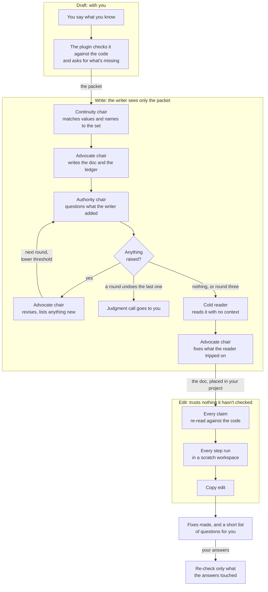

# How the authoring loop works

When you document something with the plugin, it does not simply write a document and hand it to you.
It splits the work across three isolated reviewers, each defined by what it produces and what it is forbidden to do, and the thing it hands you first is a list of what it had to guess.

This page explains that mechanism and why it is built this way.
You do not need any of it to use the plugin.
Read it if you want to know what a draft's assumptions list is worth before you trust one.

The plugin calls these reviewers chairs in its own files and in this page, because that is the word you will see if you open `agents/` or the reference material.
Reviewer and chair mean the same thing here.

## What has actually been run

The original multi-pass loop ran end to end once: the run that produced this page.
The three steps it now runs as (draft, write, edit) have been run headless three times on a small test project, and on copies of one real docs set, with the expert's answers scripted.
Those runs found real errors (a setting nothing reads, a step that nests a directory instead of replacing it), and they also found the gaps the steps were changed to close.
On the real set, the write step's questioning ran one round in one session and two in another, and the page it produced carried none of the invented details the same request picked up when it skipped the write step.

Most of what follows is therefore design checked against a few runs, not measurement.
The shape of the mechanism is real and it is in the repository.
How it behaves on a real project, with a real expert, and what a document costs to produce there, is not yet observed.
The newest [Known limits in the changelog](../CHANGELOG.md#known-limits) are the set's standing record of that gap, and this page sits on the same side of it.

## The three chairs

Each chair is a subagent with its own contract.
The contract says what the chair writes and what it may not do.
Both halves carry weight differently: a rule in a constitution is a request, and a tool the chair was never granted is a guarantee.

### The authority chair

Holds what is true about the subject.
It writes the packet: a cold, prose-free statement of the model, the claims, the causal chains, the constraints, the rationale, the misconceptions readers arrive with, and what is not known.

It may not comment on prose.
Not word choice, not structure, not heading case, not tone.

### The continuity chair

Represents the rest of the documentation set, which is the thing neither of the other two is looking at.
It changes example values, naming, and sequencing so a reader crossing several pages meets one coherent set, and it watches whether the set's stance holds.
It records every change in a substitution list.
On this page's own run, its largest finding was a naming collision: one word already meant something else to readers elsewhere in the docs.

It may not assert facts, and it may not shape prose, pick a content type, or decide architecture.
Any substitution that could change behavior goes back as a question instead of being applied, because harmonizing a value across two pages is a correctness loss when the two products genuinely differ, and that failure stays invisible until someone runs the commands.

### The advocate chair

Represents you, the reader.
It owns content type, information architecture, links, and style, and it turns the packet into the document.

It may not assert what is true, and it may not soften a limit into a suggestion.
If the packet says something cannot be done, the document says it cannot be done.

Two of the three are adversarial: authority and advocate pull against each other by design.
Continuity is not a third opinion on this document, and it is not adversarial with either.
Three chairs is not three opinions merged into a consensus, and resolving the tension would be the failure rather than the goal.

An expert working alone ships material that is correct and unreadable.
A writer working alone ships material that is clear and subtly wrong.
Pairing the two opposed failure modes is what catches what either would miss on its own, and a single reviewer asked to do both averages them into mush.

## Why they run apart

The obvious objection to this design is that one model wrote the thing and then graded its own work, so the check is theater.
The loop is built against exactly that objection.

The chairs run as separate subagents in separate contexts, and they communicate by writing files.
The advocate chair receives the packet and the substitution list.
It never receives the authority chair's reasoning, which is what guarantees that anything it adds originates with it: it had no other source to take it from.
The authority chair, in return, is shown only the ledger entries routed to it and never the draft, because reading prose pulls a reviewer toward commenting on it.

Sequential roleplay in one conversation was considered and rejected for this reason.
A context that produced the packet knows things it never wrote down, and it cannot reliably tell which of its own claims came from where.

Every artifact is a file, and the main conversation passes paths rather than contents.
That keeps the conversation's context flat no matter how large the document gets, and it makes a run resumable and every intermediate step inspectable after the session ends.
The working artifacts live under `.docs-assist/loop/`, in a directory git ignores, so none of them reaches your repository.

## The packet

The packet is the authority chair's artifact, and it is deliberately not prose.

It contains no transitions, no motivation, no audience address, no hedges, no editorializing headings, and no analogies.
Analogies are excluded on purpose, from both packet schemas: an analogy is a factual claim that two things are alike, wearing a teaching costume, so it must be proposed by the advocate chair and approved by the authority chair, in that order, and never smuggled in as raw material.

A packet is closer to a parts list than to a first draft.
The comparison breaks in one important place: a parts list only inventories, while a packet also states causes, rationale, and what the reader probably believes that is wrong.

Warming the packet up into readable prose is the one reliable way to break the loop, because the ledger is defined against what the packet omits.

Two rows carry most of the weight:

1. **Known misconceptions.** What the reader arrives believing, then what is actually the case.
   This is the row only a teacher produces, and it is the highest-value row in a concept packet.
1. **Typed provenance.** Every claim group is labeled as a code reference, an external source, or subject matter expert experience.
   A required citation column was rejected, because it forces the authority chair to either fabricate a source or refuse to state material that has no citable one.

The packet is also designed to be filled in by a person.
A packet a human wrote and a packet the authority chair emitted are the same artifact, and nothing downstream can tell them apart.
`/docs-assist:draft` is the loop with you seated in the authority chair.

That is the first of three steps a new doc goes through, each its own command:

1. **Draft** (`/docs-assist:draft`): you fill the packet by talking, and the plugin steers you toward the rows that never fill themselves, such as limits and failure modes.
1. **Write** (`/docs-assist:write`): the continuity and advocate chairs turn the packet into a document, and a cold reader reads it before you do.
1. **Edit** (`/docs-assist:edit`): every claim is checked against the code and every step is run, then the wording gets a copy edit.

They are separate for the reason the chairs are: the step that interviews you never shapes the doc, the step that writes never decides what is true, and the step that edits trusts nothing it has not checked or run.

## The ledger

The ledger is everything in the draft that has no antecedent in the packet.

It is a set difference, not a self-report.
The advocate chair does not introspect about what it thinks it assumed.
It compares two artifacts and lists what appears in the prose and not in the packet, which means entries are produced by construction rather than by recall.
An earlier version of the design did ask the chair to report its own assumptions, and that was rejected as unreliable: language models are not accurate self-reporters.

Entries are typed, and the type decides whether an entry is worth an expert's attention.

| Entry type           | What it is                                      | Goes to the authority chair |
| -------------------- | ----------------------------------------------- | --------------------------- |
| Connective prose     | Topic sentences, transitions, bridges           | No                          |
| Pedagogical ordering | Teaching one thing before another               | No                          |
| Link or relation     | A pointer to another page                       | Low priority                |
| Audience calibration | Assuming what the reader already knows          | Yes                         |
| Structural claim     | Ordering or dependency the packet did not state | Yes                         |
| Implied fact         | A gap filled with something plausible           | Always                      |
| Analogy              | A teaching comparison                           | Always                      |
| Simplification       | A caveat dropped for clarity                    | Always                      |

Implied facts are the reason the ledger exists.
A fluent writer fills a gap with something that reads exactly like the sourced sentences around it, which is why nobody catches it in review.
Analogies always route as well, and the authority chair signs off specifically on where the analogy breaks, because that is the part that belongs in the document.
Simplifications always route so that a caveat dropped for clarity becomes an approved loss rather than a silent one.

### One real entry

This page was written by the loop, so its own ledger is the honest example.
Pass 0 produced thirty-eight entries, twenty-four of which routed.
Here is one, reproduced as the advocate chair wrote it:

```markdown
### A1. "A packet is closer to a parts list than to a first draft."

**Draft:** the *The Packet* section.
**Packet antecedent:** none. Claim 63 and boundaries 3 and 4 say what the
packet is not. No comparison is offered.
**Where I think it breaks, and I said so in the draft:** a parts list only
inventories, while the packet also states causes, rationale, and the reader's
likely wrong beliefs.
**Where it may also break, and I did not say so:** a parts list is complete by
definition, and the packet has an Unknowns row, so a packet is explicitly
allowed to be incomplete in a way a parts list is not. If the authority chair
thinks that second break matters more than the first, the sentence should name
it instead.
**Routed.**
```

Three things about that entry are the whole design.

It names its own absence of a source.
The analogy is the advocate chair's invention, the packet offered no comparison, and the entry says so rather than presenting the figure as though it came from the material.

It separates what the draft already admits from what it does not.
The first break is in the prose you are reading; the second is not, and the chair flagged the gap between them rather than quietly choosing.

It is a question, not a correction.
The chair does not decide whether the analogy holds, because that is a claim about the subject, and claims about the subject belong to the authority chair.

Reviewing that costs about thirty seconds, and it is the part of the draft most likely to be wrong.
Reading the whole page to find it costs considerably more and usually fails, because a well-made analogy reads exactly like the sourced sentences around it.

Style, word choice, heading case, and formatting never enter the ledger.
Those belong to the advocate chair, and routing them would turn the loop into two agents arguing about commas.

The authority chair returns one of three verdicts on each routed entry: `confirmed`, `corrected`, or `unknowable`.
A correction must carry a citation: a file and line, a commit, an external source, or an explicit statement that it is the chair's own experience.
An uncited correction is not applied and becomes a question for you instead, because neither chair holds ground truth and two agents can agree confidently and both be wrong.

## What you actually review

The finished document is a by-product.
The stated deliverable is a short list of questions: what genuinely needs a person, with the context attached.

That choice is about your attention, not about the writing.
Four questions with context is a ten-minute task an expert will finish.
A full draft review is a task that sits in a tab.

This is the same division of labor the contributor guide describes when it says to [review for accuracy, not style](write-docs-with-docs-assist.md#review-for-accuracy-not-style).
The loop is what makes that division mechanical instead of aspirational: the questions reaching you are the ones the chairs could not settle between them.

## How the three steps use the chairs

Each step seats the chairs differently, and each hands the next one a file rather than a memory of the conversation.



1. **Draft.** You sit in the authority chair.
   The plugin interviews, checks what you say against the code as it comes up, and asks for the rows that never fill themselves, such as limits and failure modes.
1. **Write.** The continuity chair reconciles the packet with the rest of the set.
   The advocate chair, which receives the packet and the substitutions and nothing else, writes the document and its ledger.
   Then the two adversarial chairs go back and forth: the authority chair questions what the writer added, and the writer revises, until the authority chair is satisfied.
   A cold reader then reads the result in order, with no context, and the advocate chair fixes what it tripped on, or says why not, in one more pass.
1. **Edit.** Every claim is re-read against the code as it stands, including the ones the draft step and the questioning already settled, and every step is run in a scratch workspace, one section at a time.
   The copy edit comes last, because polishing a sentence the technical edit then rewrites wastes the work.

### Rounds, and when the questioning stops

A round is one review by the authority chair and one revision by the advocate chair.
Each chair loads its shared rules, its own contract, and one rulebook for the current round, and each round's rulebook lowers the threshold for what is worth raising: first what is wrong, then what the doc takes for granted, then what is true but misleading.
Nothing about tone changes between rounds.
Telling a model to be grouchier was proposed and rejected: a model told to be grouchy writes grouchy prose, it does not read more carefully.

The questioning ends on whichever of these comes first:

1. **A round that raises nothing.** That is the normal end, and a successful one.
   No minimum finding count, no target, and no quota apply, and a finding that exists only because someone was looking for it is not a finding.
   One bad finding costs more trust than silence, because a reader who gets one starts discounting the good ones.
1. **A round that undoes the last one.** It stops the questioning immediately.
   A reversal is not a defect.
   It has found a judgment call neither chair can settle, which is precisely where your scarce attention belongs.
1. **The third round.**

More rounds do not produce a better document.
In one by-hand run against documentation whose steps had already been tested, the first review found nothing, and that null result was read as the validating signal rather than as a wasted round.

## Casting

Before the write-up, the document is cast on two axes: where the truth lives, and what the reader needs.
The cast selects which packet schema is loaded and which persona the chairs are briefed with, and nothing else.
The contracts do not change with the cast, and the casting matrix is not a content-type taxonomy: [content types](../skills/docs-assist/reference/content-types.md) are a separate thing, and the advocate chair owns the choice.

Exactly one re-cast is allowed per document, and it sends the packet back to be filled again in the new shape.
A second re-cast request goes to you.

Material that needs two casts is two documents.
That rule replaced a heuristic about size and story count, because it is falsifiable and the heuristic was not.

## What the loop is not

1. **Not only a review of a finished document.** The write step produces the document.
   The edit step is where review happens, and it works the same way on a doc you already have.
1. **Not a prose polisher bolted on at the end.** The advocate chair owns the content type and the information architecture from the start.
1. **Not a linter.** Everything a script can decide runs before any chair and briefs it.
   The chairs are spent on what a script cannot decide.
1. **Not a way to remove you from documentation.** The output is a question list.
   The packet is built to be human-fillable, and the draft step is the loop with a person in the authority chair.
1. **Not free.** A new doc takes about seven subagent runs across the write and edit steps with one round of questioning, two more for each further round, and one step run per section of a procedure.
   Cost is the design's main practical objection to itself, and it is not settled.

Two things sit outside the three steps.
[`/docs-assist:merge-prep`](command-reference.md#docs-assistmerge-prep) is a separately invoked gate over the whole set rather than a step in any document's run, and the continuity chair runs in the write step and again there.
`/docs-assist:audit` is the same mechanism pointed at an existing document instead of a new one.

## Related reading

1. [Write Docs With Docs Assist](write-docs-with-docs-assist.md): what using the plugin looks like from your side, including what to bring and what to check.
1. [Command reference](command-reference.md): every command, its argument, and an example.
1. [Docs Assist 1.0 release plan](https://github.com/EdwardAngert/docs-agent-plugin/blob/working-notes/docs/1.0-release-plan.md): the maintainer-facing build order for this design, written in the future tense as a plan rather than a description of what runs today.
   It is kept on the `working-notes` branch rather than shipped with the plugin.
